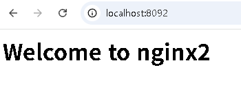
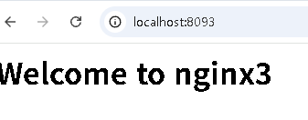

# 5주차 - Docker
- [ ] `docker --version` 정상 출력
- [ ] `docker run hello-world` 실행
- [ ] `web`이라는 이름으로 nginx 컨테이너 실행
- [ ] 브라우저 또는 `curl`로 `http://localhost:8080` 응답 확인
- [ ] `docker ps`에서 실행 상태를 확인
- [ ] 실습 결과를 `week05/README.md`에 기록
- [ ] 수업에서 만든 컨테이너 정리
- [ ] 혼자서 해보기 완료

