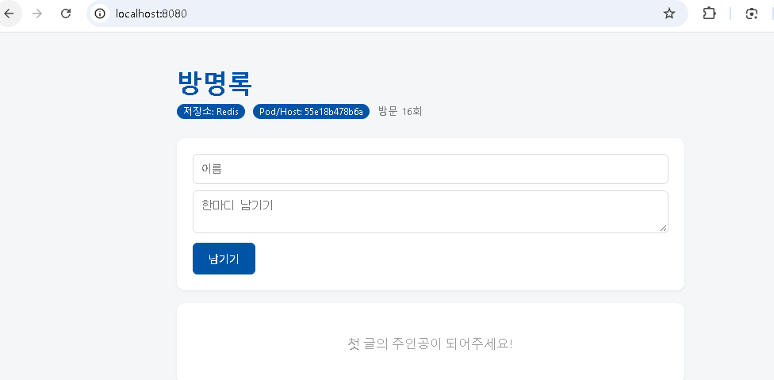
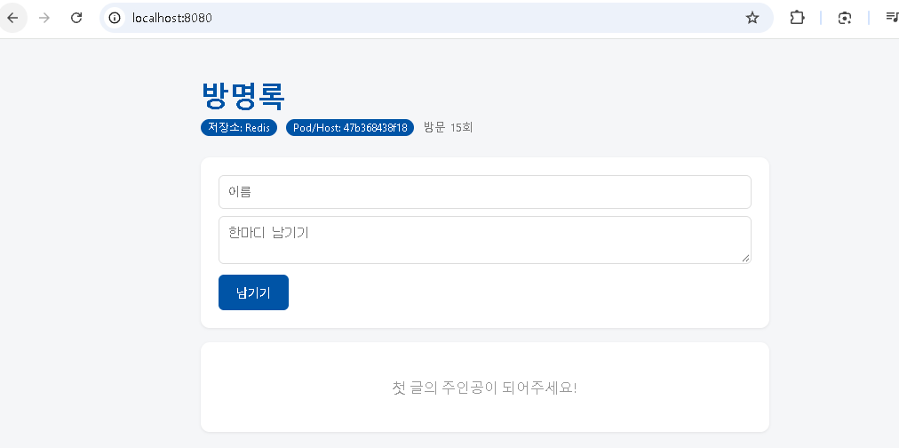
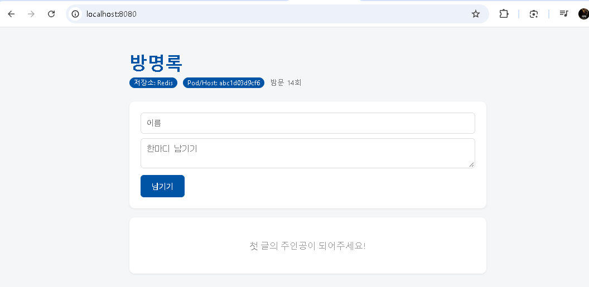
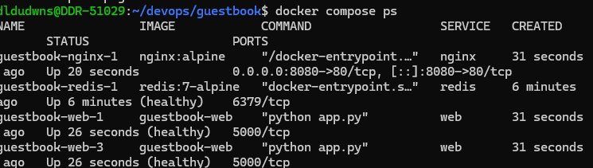

#down 후 up과 down -v 후 up 차이
down 후 up은 컨테이너와 네트워크만 끄고 완전히 삭제이다. 다만 생성된 데이터 저장소는 컴퓨터에 그대로 남겨둔다.
down -v 후 up은 컨테이너와 네트워크뿐만 아니라 그곳에 있는 볼륨의 데이터까지 전부 삭제한다.
#.env파일을 올리지 않는 이유
보안을 위해서 올리지 않는다. api혹은 비밀번호가 있을수도 있기 때문.
